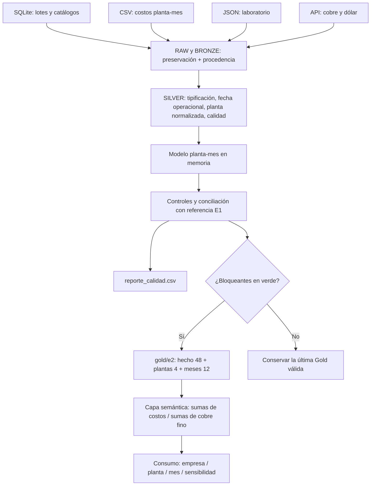

# B · Arquitectura de integración y operación de la cadena (E2)

**CuprumAndes SpA · Grupo 6 · Entrega 2**

## B.1 Arquitectura por capas y justificación

Se conserva la arquitectura **RAW → BRONZE → SILVER → GOLD → consumo**, implementada por Python 3.12, Pandas y Parquet. La cadena integra (1) lotes y catálogos de `origen_mina.sqlite`, (2) `origen_costos_planta.csv`, (3) `origen_leyes_laboratorio.json` y (4) los snapshots de precio del cobre y dólar observado procedentes de la API `mindicador.cl`. El esquema materializado en GOLD pasa de **empresa-mes (12 filas)** a **planta-mes (48 filas: 4 plantas × 12 meses)**, con `dim_planta`, `dim_tiempo` y `fact_planta_mes`. Los controles comparan el indicador E2 con el consolidado histórico E1.



| Capa | Transformación concreta | Razón de diseño |
|---|---|---|
| RAW | Preservar SQLite/CSV/JSON originales y respuestas históricas de API | Permite repetir cálculos y comparar decisiones sin reescribir la fuente |
| BRONZE | Extraer a Parquet incluyendo `source_file` y `source_row_index` | Documentar procedencia de cada registro |
| SILVER | Normalizar 4 formatos de fecha, derivar `mes` desde `fecha`, corregir tipos de montos y ley, canonizar nombres de plantas, conservar lotes inválidos marcados y vinculaciones a laboratorio | Distinguir limpieza de lógica de negocio, trazabilidad de exclusiones |
| GOLD | Producto cruzado de cuatro plantas y doce meses; sumar cobre fino a partir de lotes elegibles; integrar costo de cada planta, factor de ley de laboratorio y tipos de cambio | Permite encontrar en qué planta actuar sin falsear un consolidado incompleto |
| Semántica | `costo_directo_planta_por_libra` = SUM(costo_directo_usd) / SUM(cobre_fino_lb); costo corporativo solo si las cuatro plantas tienen costos completos | Evita promediar tasas y asegura una definición única |
| Consumo | Lectura de los tres Parquet de `gold/e2/` al finalizar la corrida | El informe o tablero aplica la misma definición del indicador |

## B.2 Tres decisiones arquitectónicas

**D1 — ETL o ELT.** Se adopta **ETL por lotes, con staging crudo previo**. El extractor aterriza copias auditables en RAW/Bronze; después Python/Pandas tipifica y transforma las fuentes en Silver, agrega la producción y costos y **carga el modelo analítico Gold ya transformado**. Esta clasificación se hace según el lugar donde ocurre la transformación: fuera de un motor de warehouse/lakehouse. El hecho de guardar una copia Bronze antes de transformar no convierte por sí mismo la solución en ELT dentro de un almacén. No se requiere streaming ni Spark/Cloud: las fuentes son heterogéneas, el histórico contiene 14.598 lotes y 45 registros planta-mes del CSV y el indicador se consulta mensualmente. Se opta por procesamiento por lotes reproducible, evitando atribuirle un motor que la solución no utiliza.

**D2 — Recarga completa e idempotencia.** Se reconstruye todo 2025. Las 48 combinaciones planta-mes tienen un costo de cálculo acotado y las inconsistencias en las fechas de origen harían frágil una carga incremental. El hecho usa la clave `(planta_id, mes)`. Los 144 identificadores de lote repetidos se conservan según la regla acordada. E2 valida las tablas en memoria y compara los ocho meses completos con la referencia de E1. Cuando aprueba, escribe los tres Parquet en una carpeta temporal y reemplaza la carpeta fija `gold/e2/`. La operación prevista es una corrida por vez.

**D3 — Falla de una fuente / API.** Los JSON históricos de `mindicador.cl` en RAW permiten reproducir la cadena sin conexión. Si falta un snapshot, la extracción intenta obtenerlo. Un error de descarga, la falta de cierres mensuales o un valor de cierre inválido bloquean la actualización de `gold/e2/`. La causa de la falla queda en `reporte_calidad.csv`.


## B.4 Linaje extremo a extremo

| Campo de hecho | Aguas arriba (origen → Silver → cálculo) | Aguas abajo (prototipo) |
|---|---|---|
| `planta_id`, `mes` | `SQLite.plantas.planta_id` + `SQLite.lotes.fecha` y `CSV.planta,mes` → normalización del mes y nombre | Filtro de planta, período y comparación por planta |
| `n_lotes`, `toneladas_tratadas` | SQLite.lotes → filtro `es_elegible` de Silver → `COUNT`, `SUM` por planta-mes | Tabla de detalle y explicación de cambios productivos |
| `cobre_fino_lb_operacional` | SQLite.lotes.toneladas,ley,recuperación → suma de `T × ley/100 × recuperación/100 × 2204,62262` | Denominador principal del KPI y evolución mensual |
| `cobre_fino_lb_laboratorio` | JSON.ley_lab_prom + lotes pareados → factor mensual calibración, aplicado a la producción de planta | Selector de ley: sensibilidad de la cifra |
| `cobre_fino_lb_simple` | SQLite.lotes → `SUM(T×rec/100) × AVG(ley)/100 × 2204,62262` por planta-mes | Selector de promedio simple |
| `energia_clp`, `insumos_clp`, `mano_obra_clp` | CSV → parseo CLP, normalización `planta`, conservación de N/A | Desglose de componentes y reporte de faltantes |
| `costo_directo_usd` | SUM de los tres costos por planta-mes / dólar observado del último día disponible del mes | Numerador del KPI; **nulo** si falta un costo |
| `precio_cobre_usd_lb` (tiempo) | API histórica → fecha válida máxima del mes | Referencia del mercado y comparación, no venta realizada |
| Costo directo por libra (derivada, no aditiva) | `e2_semantic.costo_directo_planta_por_libra`: sumas de costos / sumas de libras; requisito de completitud empresarial | Cifra principal, tendencias y comparaciones por planta |

## B.5 Acuerdo de servicio

| Componente | Objetivo acordable | Línea base E1 o limitación |
|---|---|---|
| Frescura | Corte mensual, máximo **5 días hábiles** después del cierre operativo-contable | Solo hay un histórico cerrado 2025; sin evidencia de tiempos de entrega mensual |
| Completitud | **≥95%** de los 48 pares planta-mes esperados con energía, insumos y mano de obra disponibles | 44/48 = **91,7%**, meta no alcanzada |
| Calidad | **100%** de las pruebas bloqueantes en PASA antes de publicar | 16 PASA, 2 AVISA y 0 BLOQUEA en la corrida local |

Si un mes tiene menos de cuatro plantas completas, el producto conserva los indicadores de las plantas válidas y marca «incompleto» el mes empresa. La cobertura está disponible en el hecho y el estado de los controles en el CSV separado.

## B.6 Reproducción

Desde la raíz del repositorio con Python 3.12:

```bash
python -m pip install -r requirements.txt
python -m unittest discover -s tests -v
python run_e2.py
```

`python run_e2.py` reconstruye Bronze y Silver y ejecuta los controles. La
salida aprobada consta de tres Parquet en `gold/e2/`. El indicador y la historia
se obtienen con las funciones documentadas en [README_E2_B.md](../README_E2_B.md).
Un error crítico conserva la Gold anterior y devuelve código distinto de cero.

La corrida local duró 1,584 s con los snapshots disponibles en disco. Se
verificaron los tres Parquet, las 48 claves planta-mes y la conciliación con
E1 en los ocho meses completos. El reporte registró 16 `PASA` y 2 `AVISA`.
La suite de regresión aprobó 22 pruebas. La conexión con el prototipo corresponde
a la sección D.

En una copia aislada se reprodujeron las tres tablas y el cálculo de la historia.
Una ley de laboratorio fuera de rango y una API inaccesible sin snapshot
bloquearon la ejecución, conservaron los Parquet válidos y quedaron en el CSV.

## B.7 El número y su historia

El número para el directorio es el **costo directo de planta por libra de
cobre fino operacional**. Se divide la suma de costos directos en USD por la
suma de libras de cobre fino. En el total empresa se exigen las cuatro plantas
con costos completos. La ley de laboratorio y la alternativa de promedio
simple se presentan como sensibilidades de esa definición.

La función `historia_costo_empresa_mes` deriva tres niveles de lectura a partir
del hecho y sus dos dimensiones:

| Pregunta | Evidencia disponible |
|---|---|
| ¿Cuánto costó producir una libra? | USD/lb, costos en USD, libras de cobre fino y cobertura de las cuatro plantas. |
| ¿Qué cambió? | Comparación con el último mes empresarial completo y un puente que separa el efecto del costo total en USD del efecto de las libras producidas. Ambos efectos suman la variación del indicador. |
| ¿Dónde investigar y cómo se compara con el mercado? | Composición de costos, planta de mayor costo unitario entre las disponibles, dólar observado, precio del cobre y margen de referencia. El detalle planta-mes conserva los montos y las libras de cada planta. |

El puente promedia el efecto de cambiar cada término del cociente en los dos
órdenes posibles. Modela la contribución aritmética de costos y producción.
El efecto de costos en USD incorpora la conversión cambiaria. La planta con
mayor USD/lb orienta la revisión. Para atribuir el cambio a una planta se
requieren sus costos, libras y peso en ambos meses.

**Ejemplo con la corrida verificada.** Diciembre registró **3,409 USD/lb**,
frente a **2,818 USD/lb en octubre**, el último mes completo anterior. El
costo directo en USD bajó **3,9%**, mientras las libras de cobre fino cayeron
**20,6%**. El efecto de producción sumó **0,716 USD/lb** y el efecto de costos
restó **0,125 USD/lb**, para un alza neta de **0,591 USD/lb**. El precio de
referencia subió de **5,00** a **5,53 USD/lb** y el margen de referencia pasó
de **2,182** a **2,121 USD/lb**. Noviembre conserva su marca de incompletitud
por falta de costos de Salado.
